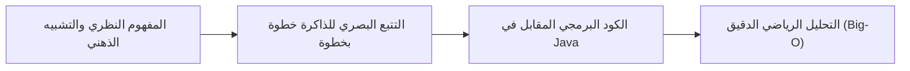
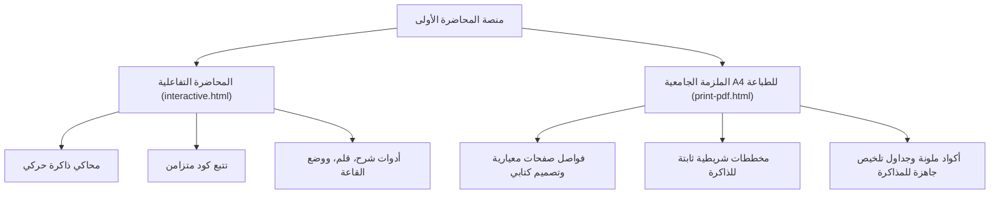

# تحليل أسلوب التدريس والمنهجية التعليمية للمحاضرة الأولى
## دراسة تحليلية شاملة لأسلوب عرض وشرح "المصفوفات في Java" (Lecture 01)
### إعداد وإشراف: م. عبدالحميد هلال دعبان

---

## 📌 الفهرس العام للتحليل
1. [المقدمة والرؤية الفلسفية للدرس](#1-المقدمة-والرؤية-الفلسفية-للدرس)
2. [الهيكل البيداغوجي والترتيب المنطقي للمفاهيم](#2-الهيكل-البيداغوجي-والترتيب-المنطقي-للمفاهيم)
3. [النموذج الثلاثي لشرح العمليات (Tripartite Teaching Model)](#3-النموذج-الثلاثي-لشرح-العمليات-tripartite-teaching-model)
4. [الربط بين العتاد (Hardware) والذاكرة والبرمجة المجرّدة](#4-الربط-بين-العتاد-hardware-والذاكرة-والبرمجة-المجردة)
5. [التفاعل البصري وتتبع الحالات الحية (Live State Tracing)](#5-التفاعل-البصري-وتتبع-الحالات-الحية-live-state-tracing)
6. [الأسلوب اللغوي، التشبيهات، وتفكيك التعقيد](#6-الأسلوب-اللغوي-التشبيهات-وتفكيك-التعقيد)
7. [التكامل بين البُعدين: التفاعلي الرقمي والورقي الأكاديمي](#7-التكامل-بين-البُعدين-التفاعلي-الرقمي-والورقي-الأكاديمي)
8. [التعليم الدفاعي والوقاية من الأخطاء البرمجية (Defensive Teaching)](#8-التعليم-الدفاعي-والوقاية-من-الأخطاء-البرمجية-defensive-teaching)
9. [نقاط القوة الاستثنائية في الدرس](#9-نقاط-القوة-الاستثنائية-في-الدرس)
10. [توصيات مقترحة للمحاضرات القادمة](#10-توصيات-مقترحة-للمحاضرات-القادمة)

---

## 1. المقدمة والرؤية الفلسفية للدرس

تتميز المحاضرة الأولى لمقرر **تراكيب البيانات (Data Structures) بلغة Java** بانتقالها النوعي من أسلوب الإلقاء التلقيني التقليدي السائد في الجامعات إلى نموذج **التعلم البصري التجريبي النشط (Active Visual-Experiential Learning)**.

تقوم الفلسفة التعليمية للمحاضرة على مبدأ جوهري:
> **"البرمجة ليست مجرد كتابة نصوص، بل هي حركة بيانات في الذاكرة وإدارة واعية لاستهلاك موارد المعالج."**

ولتحقيق هذه الفلسفة، تم بناء الدرس بحيث لا يرى الطالب الكود كأمر سحري، بل يرى بالعين المجردة ما يحدث داخل خلايا الذاكرة الفيزيائية مع كل تعليمة برمجية تُنفّذ.



---

## 2. الهيكل البيداغوجي والترتيب المنطقي للمفاهيم

اعتمد المحاضر هندسة تسلسلية متدرجة ذكية تُعرف في أصول التدريس بـ **(Scaffolding & Prerequisite-First Flow)**:

```text
[1. مدخل التعقيد وكفاءة الكود Big-O]
                 ⬇
[2. تشريح المصفوفة في الذاكرة RAM وعناوين البايتات]
                 ⬇
[3. تفكيك العمليات الـ 9 تفاعلياً (الوصول، البحث، التعديل، الإدراج، الحذف...)]
                 ⬇
[4. مرجع أكواد العمليات الأربع الأساسية CRUD في Java]
                 ⬇
[5. المراجعة والمقارنة الشاملة وجدول المفاضلة]
```

### أ. البدء بمفهوم التعقيد الزمني (Complexity First):
بدلاً من البدء التقليدي بتعريف المصفوفة `int[] arr = new int[5]`، استهل الدرس بشرح **كيف نقيس كفاءة الكود؟ وما هو Big-O؟**
- **الهدف البيداغوجي:** زرع معيار التقييم والحس النقدي لدى الطالب مسبقاً، حتى عندما يدرس عمليات المصفوفة لاحقاً، يفهم مباشرة لماذا نقول عن عملية الوصول إنها ممتازة $O(1)$ ولماذا الإدراج والحذف مكلفان $O(n)$.
- **طرح تساؤلات إشكالية تحفز التفكير:**
  - *لماذا لا نقيس الكفاءة بالثواني؟* (توضيح أثر اختلاف العتاد وأنظمة التشغيل).
  - *ماذا تعني $n$ رياضياً؟* (تجريد حجم المدخلات).

### ب. الانتقال للتشريح الفيزيائي للذاكرة (Memory Anatomy):
قبل كتابة العمليات، تم شرح طريقة توطين المصفوفة ككتلة متجاورة (Contiguous Memory Block) في الذاكرة العشوائية RAM، وعلاقة حجم النوع `int` (4 بايتات) بحساب العناوين.

---

## 3. النموذج الثلاثي لشرح العمليات (Tripartite Teaching Model)

الركيزة الأساسية في أسلوب الدرس هي **التقسيم الثلاثي الموحد لكل عملية برمجية** من العمليات التسع:

| الشريحة التعليمية | المضمون والدور الوظيفي | الهدف البيداغوجي |
| :--- | :--- | :--- |
| **① الفكرة (The Intuition)** | صياغة الهدف باللغة الطبيعية + خطوات خوارزمية مرقمة + تشبيه واقعي (Analogy). | كسر الحاجز النفسي وبناء نموذج ذهني أولي سهل الفهم. |
| **② التنفيذ خطوة بخطوة (Execution)** | محاكي تفاعلي حي يعكس حركة المصفوفة + تظليل متزامن لكود Java + صندوق قيم المتغيرات. | ربط السطر البرمجي المكتوب بالأثر الفعلي الحاصل في الذاكرة. |
| **③ التحليل والتعقيد (Analysis)** | مقارنة الحالات (Best / Average / Worst) + اشتقاق رياضي دقيق + خلاصة مستفادة (Takeaway). | ترسيخ مهارة تحليل الخوارزميات والانتقال من مرحلة المبرمج الهاوي للمهندس الأكاديمي. |

### تطبيق توضيحي من الدرس (عملية الإدراج Insert):
1. **الفكرة:** تقسيم الإدراج إلى 3 مراحل جلية:
   - *مرحلة 1:* حجز مصفوفة جديدة ونسخ ما قبل الموقع.
   - *مرحلة 2:* غرس العنصر الجديد.
   - *مرحلة 3:* إزاحة ونسخ بقية العناصر لليمين (+1).
2. **التنفيذ:** يرى الطالب مصفوفة `result` تتكون تدريجياً أسفل المصفوفة الأصلية مع انتقال الأسهم الملونة.
3. **التحليل:** إثبات لماذا أخذت $O(n)$ حتى في أفضل الحالات عند إضافة العنصر في النهاية (بسبب حتمية إنشاء مصفوفة جديدة ونسخ كل العناصر القديمة إليها في Java).

---

## 4. الربط بين العتاد (Hardware) والذاكرة والبرمجة المجرّدة

من أندر وأقوى ميزات أسلوب المحاضرة هو **النزول إلى مستوى المعمارية المادية للذاكرة**، وعدم الاكتفاء بالصيغ البرمجية الجافة:

$$Address = Base + (Index \times Size)$$

- **تفسير سحر الوصول اللحظي $O(1)$:**
  يوضح المحاضر أن المعالج لا يقوم ببحث أو دوران عبر حلقة للوصول إلى `arr[3]`، بل ينفذ عملية ضرب وجمع حسابية مباشرة في المسجلات في دورة ساعة واحدة، ليصل إلى العنوان الفيزيائي `0x100C`.
- **التفسير المنطقي لثبات الحجم في Java:**
  يشرح الدرس لماذا لا نستطيع عملياً توسيع مصفوفة قائمة في لغة Java؛ لأن المساحة التالية للمصفوفة في الذاكرة العشوائية قد تكون محجوزة لمتغيرات أخرى لبرامج أخرى، مما يفرض علمياً إنشاء مساحة جديدة كلياً في حال الإضافة أو الحذف.

---

## 5. التفاعل البصري وتتبع الحالات الحية (Live State Tracing)

اعتمد الدرس معمارية برمجية تفاعلية دقيقة (State-Recorder Pattern)، مكنت المتعلم من الحصول على تجربة تحكم كاملة:

### أ. مشغل المحاكاة الموجه لاتجاه القراءة العربي (RTL-First Controls):
ترتيب أزرار التحكم يحترم سيكولوجية الاتجاه الزمني في اللغة العربية (من اليمين نحو اليسار):
- `⏭` البداية.
- `→` خطوة للخلف.
- `▶` تشغيل / إيقاف مؤقت.
- `←` خطوة للأمام.
- `⏮` الانتقال للخطوة الأخيرة.

### ب. لوحة عدادات الجهد الحسابي (Live Workload Counters):
تحديث لحظي لثلاثة مقاييس أثناء تحرك الكود:
- 📖 **عدد القراءات (Memory Reads):** كم مرة تم استخراج قيمة من خلية ذاكرة.
- ✏️ **عدد الكتابات (Memory Writes):** كم مرة تم تعديل قيمة داخل خلية.
- ⚖️ **عدد المقارنات (Comparisons):** كم شرطاً منطقياً تم اختباره في الحلقات والجمل الشرطية.

> [!NOTE]
> هذا الأسلوب ينقل الطالب من فكرة "Big-O رمز نظري مجرد في الكتب" إلى إدراك أن Big-O هو عدد دقيق للعمليات الحقيقية التي ينفذها المعالج.

### ج. الترميز اللوني الدلالي المتناسق (Color-Coded Feedback):
- **الأزرق الملكي الخفيف:** للخلية النشطة التي يقف عليها الفهرس `i`.
- **الأصفر التحذيري الخفيف:** للخلية الجاري مقارنتها.
- **الأخضر النعناعي:** للعنصر الذي تم العثور عليه بنجاح أو استقر في موقعه الصحيح.
- **الأحمر الناعم:** للخلية التي يتم حذفها أو العناصر التي يُجرى استبدالها (Swap).

---

## 6. الأسلوب اللغوي، التشبيهات، وتفكيك التعقيد

يتميز الطرح اللغوي للمحاضر بالجمع بين **الدقة الأكاديمية الصارمة** و**البساطة التقريبية الممتعة**:

### استخدام التشبيهات الحياتية الذكية (Pedagogical Analogies):
- **الوصول المباشر $O(1)$:**
  > *"مثل خزائن مرقمة في ممر طويل: إذا عرفت رقم خزانتك تتجه إليها مباشرة دون الحاجة لفتح وتفقد الخزائن التي تسبقها."*
- **المرور والجمع $O(n)$:**
  > *"مثل أمين صندوق يعد النقود ورقةً ورقة؛ محال أن يعرف المجموع الإجمالي دون أن يلمس كل ورقة بيده مرة واحدة على الأقل."*
- **إيجاد الأكبر والأصغر (Min / Max):**
  > *"مثل اختيار أطول طالب في الصف: توقف أول طالب مؤقتاً كمرجع، ثم تدعو الطلاب واحداً تلو الآخر للمقارنة وتستبدل الواقف إذا كان القادم أطول منه."*
- **عكس المصفوفة بمؤشرين (Two-Pointers):**
  > *"مثل صف من الطلاب يتبادلون أماكنهم طرفياً: الأول مع الأخير، الثاني مع قبل الأخير، حتى يلتقيا في المنتصف دون الحاجة لغرفة أخرى."*
- **الإدراج والحذف:**
  > *"مثل إضافة أو إزالة كرسي في صف مسرح مكتمل؛ لا يمكن حشره في المكان، بل يجب نقل الجميع لصف جديد مع تقديم مقاعدهم أو تأخيرها."*

---

## 7. التكامل بين البُعدين: التفاعلي الرقمي والورقي الأكاديمي

أحد أبرز إبداعات الدرس هو **ثنائية القنوات التعليمية المتكاملة**:



- **في صفحة التفاعل:** تركيز على الحركة، وتغيير المعاملات التفاعلية، وتجربة أرقام جديدة، ومشاهدة الحلقات التكرارية تدور في الزمن الحقيقي.
- **في صفحة الطباعة (PDF):** تحويل الحركة إلى **مخططات شريطية متجهة ثابتة** تُظهر عناوين الذاكرة، الفهارس، القيم، والأسهم التوضيحية مع الالتزام الصارم بمعايير الطباعة الأكاديمية (منع انقسام الجداول أو الأكواد عبر الصفحات بفضل `break-inside: avoid`).

---

## 8. التعليم الدفاعي والوقاية من الأخطاء البرمجية (Defensive Teaching)

لم يقتصر أسلوب الشرح على توضيح "كيف ينجح الكود"، بل ركّز بعمق على **"أين يقع الطلاب عادة في الأخطاء الشائعة وكيف يتفادونها"**:

- **تنبيه الحدود القاتل (Out of Bounds Trap):**
  شرح متكرر لسبب بدء الفهرس من `0` وانتهائه عند `length - 1`، مع التشديد على كتابة شرط التكرار دائماً `i < arr.length` والتحذير من كتابة `i <= arr.length`.
- **فحوصات الحماية (Validation Checks):**
  تضمين فحوصات الأمان في كود دالة التعديل `update`:
  ```java
  if (index >= 0 && index < arr.length) {
      arr[index] = newVal;
  } else {
      System.out.println("خطأ: الفهرس خارج حدود المصفوفة!");
  }
  ```
- **حفظ المتغيرات أثناء التبديل (Temp Variable Pitfall):**
  إبراز الحاجة لمتغير وسيط `temp` عند التبديل في عكس المصفوفة أو الترتيب الفقاعي، وتفسير ماذا يحدث إذا تم إسناد `arr[L] = arr[R]` مباشرة دون حفظ القيمة الأصلية.

---

## 9. نقاط القوة الاستثنائية في الدرس

1. **الشمولية الأكاديمية والتطبيقية:** المادة تغطي الجانب النظري الرياضي (Big-O)، والجانب المعماري المنطقي (Memory Layout)، والجانب البرمجي الصرف (Java Implementation)، والجانب التحليلي المقارن.
2. **برنامج تجريبي متكامل (`Main.java`):** تقديم مثال موحد في نهاية الدرس يربط كافة الدوال الأربع (Insert, Update, Delete, Search) في برنامج واحد متكامل يسهل نسخه وتجريبه في أي بيئة تطوير (IntelliJ, NetBeans, Eclipse).
3. **أدوات داعمة للمحاضر والطالب في القاعة:**
   - **قلم الشرح التفاعلي (Screen Drawing Pen):** للتأشير والرسم المباشر أثناء المحاضرة الجامعية.
   - **وضع العرض (Auditorium Mode):** لتكبير النصوص والرموز تلقائياً لكي يرى الطلبة في المقاعد الخلفية للقاعة كل تفصيلة.
4. **الخلو التام من التعقيد البرمجي للمنصة:** العمل بتقنيات الويب القياسية النقية (Vanilla JS/CSS/HTML) دون الحاجة لخوادم أو تثبيت حزم، مما يجعل المادة سريعة للغاية وسهلة الوصول من أي جهاز أو هاتف.

---

## 10. توصيات مقترحة للمحاضرات القادمة

للبناء على هذا النجاح المتميز في المحاضرات اللاحقة (مثل *Linked Lists, Stacks, Queues, Trees*)، يُقترح ما يلي:

1. **إضافة اختبارات ذاتية سريعة (Micro-Quizzes):**
   وضع سؤال اختيار من متعدد أو تتبع كود (Tracing Quiz) بعد كل عملية، يطلب من الطالب تخمين مخرجات خطوة معينة أو تعقيدها قبل أن تظهر له النتيجة.
2. **صندوق تجربة الكود الحي (Live Code Sandbox):**
   إتاحة نافذة تعديل بسيطة على كود Java تتيح للطالب تغيير شروط الحلقات واختبار مصفوفات مخصصة ورؤية أثرها فوراً على المحاكي.
3. **زر نسخ ومشاركة الخطوات (Step Snapshot Export):**
   تمكين الطالب من نسخ لقطة بصرية للذاكرة أو تنزيل ملخص العملية بصيغة صورة لإدراجها في مذكراته الشخصية.

---

### الخلاصة النهائية للتحليل
> يمثل أسلوب الدرس في المحاضرة الأولى نموذجاً يحتذى به في التعليم الجامعي الحديث لعلوم الحاسوب؛ حيث يردم الفجوة التاريخية بين النظرية الرياضية الجافة والتطبيق البرمجي العملي، واضعاً الطالب في مركز العملية التعليمية عبر التجربة والملاحظة البصرية المباشرة.

---
*تم توثيق هذا التحليل وإعداده كمرجع أكاديمي لمنهاج تراكيب البيانات والخوارزميات 2026-2027م.*
