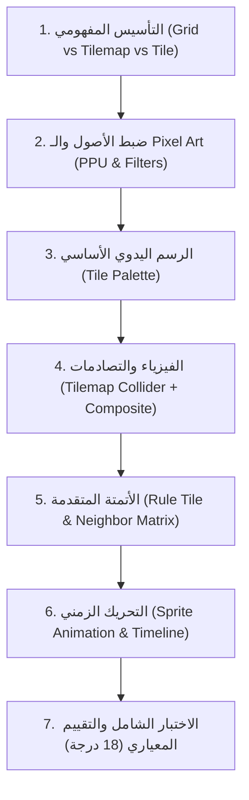

# تحليل الأسلوب البيداغوجي والمنهجية التعليمية لدرس Unity 2D
## دراسة تحليلية لأسلوب "إنشاء Tilemap ورسم العالم بـ Rule Tile والتحريك" (Unity 2D Lab 01)
### إعداد وأستاذ المقرر: أ. أحمد علي
### تصميم وتطوير المنصة التعليمية: م. عبدالحميد هلال دعبان

---

## 📌 الفهرس العام للتحليل
1. [المقدمة والرؤية الفلسفية للدرس](#1-المقدمة-والرؤية-الفلسفية-للدرس)
2. [الهيكل البيداغوجي والتدرج الهرمي (Scaffolding)](#2-الهيكل-البيداغوجي-والتدرج-الهرمي-scaffolding)
3. [التحليل المفهومي: التجريد قبل النقر (Concept First)](#3-التحليل-المفهومي-التجريد-قبل-النقر-concept-first)
4. [هندسة الأتمتة الذكية: تفكيك منطق الـ Rule Tile](#4-هندسة-الأتمتة-الذكية-تفكيك-منطق-الـ-rule-tile)
5. [ربط الوسائط والفيزياء (Multimodal Engineering)](#5-ربط-الوسائط-والفيزياء-multimodal-engineering)
6. [التقييم الموضوعي الشفاف (Objective Rubrics)](#6-التقييم-الموضوعي-الشفاف-objective-rubrics)
7. [دليل التدريس الميداني وتفادي الأخطاء (Teacher Playbook)](#7-دليل-التدريس-الميداني-وتفادي-الأخطاء-teacher-playbook)
8. [كيف تم تطبيق هذا الأسلوب برمجياً وتصميمياً في المنصة؟](#8-كيف-تم-تطبيق-هذا-الأسلوب-برمجياً-وتصميمياً-في-المنصة)

---

## 1. المقدمة والرؤية الفلسفية للدرس

يقدم هذا الدرس نموذجاً تعليمياً رفيع المستوى في مجال **تطوير الألعاب باستخدام Unity 2D**. ينتقل الدرس من مجرد "سرد خطوات وضغط أزرار" إلى **بناء الفهم الهندسي والمنطقي للبيئة ثنائية الأبعاد**.

الفلسفة الجوهرية للدرس:
> **«إنشاء العوالم في ألعاب الفيديو ليس مجرد رسم حر، بل هو نظام شبكي منظم (Grid System)، وتوزيع طبقي مدروس (Layer Hierarchy)، وأتمتة شَرطية ذكية (Rule-based Automation).»**

---

## 2. الهيكل البيداغوجي والتدرج الهرمي (Scaffolding)

اعتمد الأستاذ أحمد علي تسلسلاً منطقياً صارماً ينطلق من المفردة الصغرى إلى العالم المركب:

---

## 3. التحليل المفهومي: التجريد قبل النقر (Concept First)

أحد أقوى عناصر الأسلوب هو عدم فتح برنامج Unity إلا بعد بناء **نموذج ذهني ثلاثي الأبعاد للمفاهيم**:
- **Grid:** شبكة الإحداثيات الرياضية (دفتر المربعات).
- **Tilemap:** سطح الرسم التابع للشبكة (الورقة الشفافة).
- **Tile:** الوحدة الرسومية الفردية (الختم أو الرسمة داخل المربع).

كذلك معالجة مشكلة شائعة جداً في كليات الحاسوب وهي **تشوه رسومات Pixel Art**؛ حيث يوضح الدرس علمياً لماذا نختار `Point (no filter)` ونلغي الـ `Compression`، وكيف يؤثر `Pixels Per Unit (PPU)` على تناسق أحجام العناصر داخل اللعبة.

---

## 4. هندسة الأتمتة الذكية: تفكيك منطق الـ Rule Tile

ينقل الدرس الطالب من عقلية "الرسام التقليدي" إلى عقلية "مهندس الأنظمة":
- بدلاً من رسم 9 قطع مختلفة يدوياً (أطراف وزوايا ووسط)، يتم استخدام **Rule Tile**.
- تفكيك مصفوفة الجوار الـ 8 (`NW, N, NE, W, X, E, SW, S, SE`) كدوال شرطية (`This`, `Not This`, `Don't Care`).
- تعليم الطالب التفكير الشَّرطي: "ماذا يرى المحرك حول الخلية ليقرر إظهار هذا الـ Sprite؟".

---

## 5. ربط الوسائط والفيزياء (Multimodal Engineering)

لا يكتفي الدرس بالجانب الجمالي للرسم، بل يربطه فورياً بالفيزياء:
- إضافة `Tilemap Collider 2D`.
- شرح مشكلة فواصل الخلايا ولماذا نحتاج `Composite Collider 2D`.
- التنبيه على كارثة سقوط الأرضية في حال لم يُضبط `Rigidbody 2D` على `Static`.

ثم يضيف بُعد الحركة (2D Sprite Animation) لربط الصورة الجامدة بالحياة عبر `Animation Clip`، و `Animator Controller`، وتعديل سرعة الإطارات `Samples` وتكرار `Loop Time`.

---

## 6. التقييم الموضوعي الشفاف (Objective Rubrics)

وجود مصفوفة تقييم واضحة محددة بـ **18 درجة** موزعة بدقة على 7 معايير عملية:
- تنظيم الطبقات (2)
- استيراد الصور وتجهيزها (2)
- لوحة الرسم Tile Palette (3)
- إعداد الـ Rule Tile (4)
- التصادم واختباره (2)
- إعداد وتشغيل الأنيميشن (4)
- التنظيم وحفظ المشهد (1)

---

## 7. دليل التدريس الميداني وتفادي الأخطاء (Teacher Playbook)

يشتمل الدرس على جانب تطبيقي نادر للمدرس:
- استراتيجية **Check-and-Go** (اعرض النتيجة ← اشرح المفهوم ← طبّق خطوة ببطء ← اسأل سؤال تحقق ← افتعل الخطأ عمدًا).
- جدول شامل لاستكشاف الأخطاء الشائعة (Troubleshooting) وإصلاحها فورياً.

---

## 8. كيف تم تطبيق هذا الأسلوب برمجياً وتصميمياً في المنصة؟

قام المصمم والمهندس **عبدالحميد هلال دعبان** بتحويل هذا المنهج إلى تجربة رقمية تفاعلية ثرية متوافقة 100% مع معمارية المنصة:

1. **المسار الهيكلي:**
   - مجلد المحاضرة: `courses/unity-game-dev/lecture-01/`.
2. **الصفحة التفاعلية (`interactive.html`):**
   - **محاكي رسم Tilemap تفاعلي بالماوس:** شبكة حية تتيح للطلاب تجربة الرسم والتنظيف والملء مباشرة في المتصفح.
   - **محاكي قواعد Rule Tile الحي:** مصفوفة 3x3 تفاعلية يمكن للطالب النقر على أي جار لرؤية كيف يتغير الـ Sprite في المنتصف تلقائياً.
   - **محاكي حركة الـ Sprites:** مشغل حركي متكامل مع شريط تحكم بالسرعة (Samples FPS)، وزر إيقاف وتشغيل، وتفعيل الـ Loop.
   - **حاسبة الدرجات التفاعلية:** لتمكين الطالب والأستاذ من احتساب الدرجة الـ 18 فورياً.
   - **جدول المشكلات القابل للبحث الفوري:** للوصول للحل في ثوانٍ.
3. **الملزمة الأكاديمية الورقية (`print-pdf.html`):**
   - غلاف أكاديمي فاخر بنظام A4.
   - مصفوفات توضيحية ومخططات نظيفة جاهزة للطباعة والتصدير.
4. **نسب الحقوق والمسؤوليات بوضوح تام:**
   - **إعداد وأستاذ المقرر:** أ. أحمد علي.
   - **تصميم وتطوير المنصة:** م. عبدالحميد هلال دعبان.
